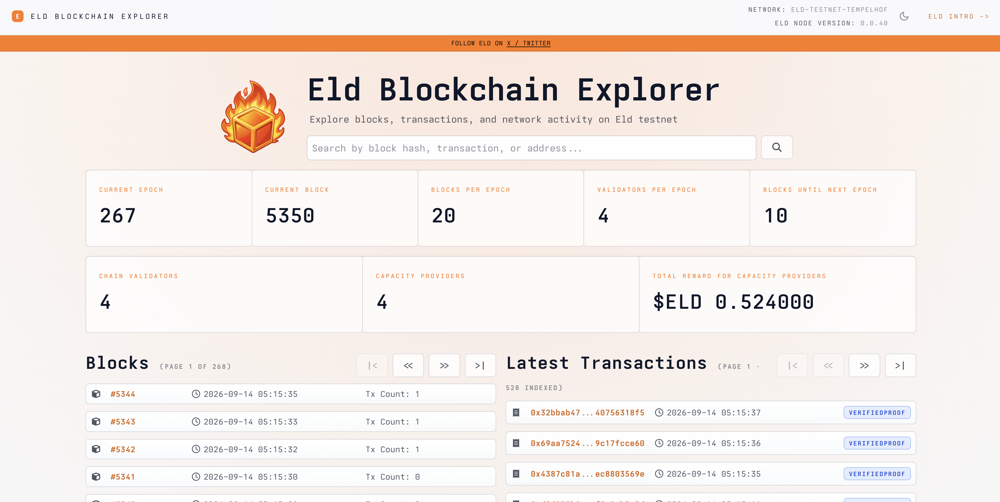

# Eld Blockchain Explorer


[](LICENSE)
[](https://github.com/eldnetwork/eld-blockchain-explorer/actions/workflows/ci.yml)
[](https://explorer.eld.network)
[](https://github.com/eldnetwork/eld-blockchain-explorer/stargazers)

Eld Blockchain Explorer is the public block explorer UI for the [Eld](https://www.eld.network) decentralized ephemeral storage protocol, built with [Vite](https://vitejs.dev/) and React.

**Live site:** [https://explorer.eld.network](https://explorer.eld.network)



## Disclaimer

This repository is the **explorer frontend only** — not the Eld protocol, consensus node, indexer, SDKs, or a wallet.

- It reads public RPC and indexer HTTP APIs; it does not custody keys or submit transactions.
- Displayed chain data depends on those backends and may be incomplete, delayed, or wrong.
- The UI uses **capacity provider** as the product term for that role.
- For protocol docs and the marketing site, see [Documentation](https://docs.eld.network) and [eld.network](https://www.eld.network).

## Architecture

```text
Browser (React SPA)
  └─ App → ExplorerAppShell → AppRoutes → pages/
       ├─ api/            shared RPC + indexer HTTP (timeout, abort, cache)
       ├─ hooks/          data hooks built on api/ (poll + chain head)
       ├─ components/     shared UI (lists, shell, footer, …)
       ├─ utils/          search resolver, formatting, helpers
       └─ config/         RPC_URL, API_URL, feature flags
              │
              ├─ VITE_RPC_URL  → Tendermint / node RPC
              └─ VITE_API_URL  → explorer / indexer API
```

| Layer                                | Role                                                                          |
| ------------------------------------ | ----------------------------------------------------------------------------- |
| `src/App.js`                         | `BrowserRouter` entry                                                         |
| `src/components/ExplorerAppShell.js` | chrome (header, theme, footer)                                                |
| `src/AppRoutes.js`                   | client-side routes (+ error boundary, 404)                                    |
| `src/pages/`                         | route screens (home, block, tx, account, validators, pinboard, …)             |
| `src/api/`                           | typed HTTP helpers for RPC and indexer; `queryCache.js` shares inflight + TTL |
| `src/hooks/`                         | data hooks on `src/api/` (`useAsyncResource`, `useLatestHeight`)              |
| `src/config/`                        | env-backed endpoints and optional validator admin status maps                 |

Static output is a Vite `build/` folder; deploy that behind any static host / CDN.

## Polling

The explorer is a public SPA. Many open tabs would otherwise hammer Tendermint RPC and the indexer on a lockstep 10s (or faster) beat. Polling is built on `useAsyncResource`, not TanStack Query.

1. **Pause when hidden + jitter.** Pollers use a recursive timeout, skip ticks while `document.hidden`, and add ±20% jitter so many tabs do not synchronize. Background tabs stop polling (`enabled` is ANDed with page visibility). Helpers: `src/hooks/usePageVisible.js`, `src/utils/pollSchedule.js`.
2. **Share in-flight requests.** `src/api/queryCache.js` `cachedFetch(key, fetcher, { ttlMs })` dedupes concurrent callers and serves a short TTL (for example `/status` ~3s, validators ~4s). Cached fetchers ignore subscriber abort; unmount only stops listening. TTL and tab visibility bound the work.
3. **Poll the chain head once.** `useLatestHeight` owns `/status` (~8s jittered, one timer per tab). Block, tx, epoch, namespace, and pinboard lists refetch when height changes (`refreshKey`), not on their own 10s loops. Validators, capacity providers, and the rewards sum use a slower ~30s poll plus a refresh when height jumps by 20.

One focused home tab: one status poll plus list fetch on new height. The same tab backgrounded: ~0 RPC. Two components that need `active_validators`: one HTTP call via `cachedFetch`.

Do not add TanStack Query for this. Do not “fix” load by only raising intervals to 60s (home feels dead; hidden tabs still poll). Do not put a service worker in front of Tendermint RPC (stale chain data is worse than extra requests).

Key files:

- `src/hooks/useAsyncResource.js` — abortable fetch, visibility, jittered poll, `refreshKey`
- `src/hooks/useLatestHeight.js` — singleton `/status` → latest height
- `src/hooks/usePageVisible.js` / `src/utils/pollSchedule.js`
- `src/api/queryCache.js` — inflight Map + TTL Map
- Height-driven lists: `useBlocks`, `useTransactions`, `useEpochs`, `useNamespaces`, `useEpochInfo`, `usePinboardPosts`
- Slower poll: `useValidators`, `useCapacityProviders`, `useVerifiedProofRewardsSum`

## Prerequisites

- [Node.js](https://nodejs.org/) >= 20

## Local development

```bash
npm install
cp .env.example .env.development
cp .env.example .env.production
npm start
```

Dev server: [http://localhost:3000](http://localhost:3000). Vite loads `.env.development` for `npm start` / `npm run dev`.

Calling production RPC/API hosts from `localhost` may fail CORS; use local backends, Vite’s `/rpc` and `/api` proxies, or an allowlisted origin.

### Environment variables

| Variable                             | Required | Description                                                                         |
| ------------------------------------ | -------- | ----------------------------------------------------------------------------------- |
| `VITE_RPC_URL`                       | yes      | Tendermint / node RPC base URL (default `http://localhost:26657`)                   |
| `VITE_API_URL`                       | yes      | Explorer / indexer API base URL (default `http://localhost:9001`)                   |
| `VITE_ENABLE_VALIDATOR_ADMIN_STATUS` | no       | `true` to load optional per-validator admin status URLs (dev-oriented; default off) |

When the flag is on, URL maps come from committed JSON:

- `src/config/validator-admin-status-urls.development.json` — localhost examples for local runs
- `src/config/validator-admin-status-urls.production.json` — empty by default; add production URLs here if needed

## Scripts

| Script                      | Description                                                                           |
| --------------------------- | ------------------------------------------------------------------------------------- |
| `npm start` / `npm run dev` | Vite dev server                                                                       |
| `npm run build`             | Production build → `build/`                                                           |
| `npm run preview`           | Serve the production build locally                                                    |
| `npm test`                  | Vitest (single run)                                                                   |
| `npm run test:watch`        | Vitest watch mode                                                                     |
| `npm run lint`              | ESLint                                                                                |
| `npm run format`            | Prettier write                                                                        |
| `npm run format:check`      | Prettier check                                                                        |
| `npm run ci`                | `format:check` → `lint` → tests → `npm audit --omit=dev --audit-level=high` → `build` |

```bash
npm run ci
```

## Releasing

Merges to `main` (and work on feature branches) do **not** deploy the live site. Production updates are gated by version tags and GitHub Releases:

1. Land the changes on `main` and wait for [CI](https://github.com/eldnetwork/eld-blockchain-explorer/actions/workflows/ci.yml) to pass.
2. Align `package.json` `"version"` with the release (e.g. `1.2.3`), then create and push a semver tag from that commit:

   ```bash
   git checkout main
   git pull
   git tag v1.2.3
   git push origin v1.2.3
   ```

3. Pushing the tag runs the **Draft release** workflow, which opens a **draft** GitHub Release (with generated notes). Nothing is deployed yet.
4. Review the draft under [Releases](https://github.com/eldnetwork/eld-blockchain-explorer/releases), edit notes if needed, then **Publish release**.
5. Publishing triggers the **Deploy production** workflow, which builds the tagged commit and updates [explorer.eld.network](https://explorer.eld.network).

Only tags matching `v*.*.*` (for example `v1.2.3`) participate in this flow. Tags must point at a commit that is on `main`.

## Links

- [Documentation](https://docs.eld.network)
- [Marketing site](https://www.eld.network)
- [X / Twitter](https://x.com/eld_network)

## License

MIT — see [LICENSE](LICENSE).

Font files in `src/fonts/` are [Ioskeley Mono](https://github.com/ahatem/IoskeleyMono), licensed under the SIL Open Font License 1.1 — see [src/fonts/LICENSE](src/fonts/LICENSE).
